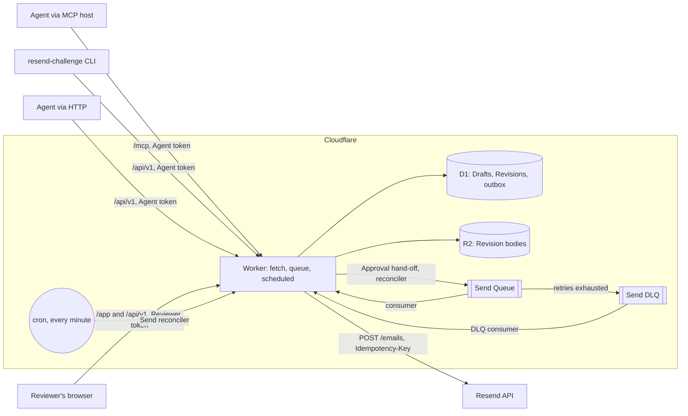
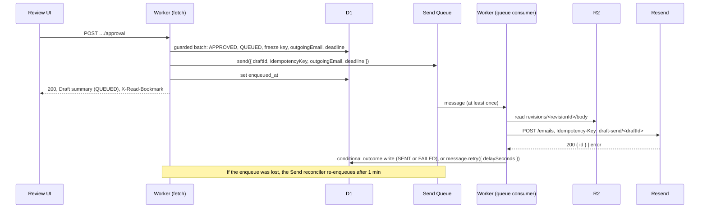

# Spec: Email Draft Approval

Status: ready to build. This document states the final decisions only; the reasoning behind them and the alternatives that were considered are in the documents listed under [Sources](#18-sources).

## 1. Overview

Email Draft Approval is a gate between Agents that compose emails and a human Reviewer who must approve each email before it is sent. Agents create Drafts, revise them (every change produces a new immutable Revision) and submit a specific Revision for review. The Reviewer approves or rejects that exact Revision in the Review UI. An Approval triggers the Send through Resend automatically, and each approved Draft sends at most one email, exactly once unless the Send fails.

The domain vocabulary is defined in [GLOSSARY.md](../../GLOSSARY.md); this spec uses its terms (Agent, Reviewer, Review UI, Draft, Draft data, Revision, Submission, Pending, Decided, Superseded, Approval, Rejection, Send) without redefining them. Terms that exist only in the implementation (Draft summary, Send reconciler, outbox columns, read bookmark) are defined where they are introduced.

The system is one Cloudflare Worker at `https://resend-challenge.patricktree.me`:

- an HTTP API under `/api`, described by a published OpenAPI document, used by everyone through one typed TypeScript client;
- an MCP server at `/mcp` and a CLI `resend-challenge`, both built on that client, for Agents;
- the Review UI, a React SPA under `/app`, for the Reviewer;
- D1 as the single source of truth, R2 for Revision bodies, one Queue (plus a dead-letter queue) that drives every Send, and a cron-driven Send reconciler.

The challenge's input is [spec-input.md](spec-input.md). Everything is written in TypeScript.

Prerequisites for building (not part of the system): a Cloudflare account with the `patricktree.me` zone, and a Resend account whose team serves this system alone, since Resend's rate limit (10 requests per second) applies per team.

## 2. Requirements coverage

| Requirement (from the input spec)                                        | How it is met                                                                                                                                                                      | Section                                                         |
| ------------------------------------------------------------------------ | ---------------------------------------------------------------------------------------------------------------------------------------------------------------------------------- | --------------------------------------------------------------- |
| The user can list pending email drafts                                   | The Review UI's Pending list (`reviewStatus=PENDING`, longest-waiting first)                                                                                                       | [11](#11-review-ui)                                             |
| The user can open a pending email draft for review                       | Row link to the Draft page `/app/drafts/{draftId}`; Agents hand out the same link as `reviewUrl`                                                                                   | [11](#11-review-ui)                                             |
| The user can see the email draft's data                                  | The Draft page shows recipients, subject and the full plain-text body of the latest Revision                                                                                       | [11](#11-review-ui)                                             |
| The user can approve an email draft                                      | "Approve" on the Draft page → `POST …/revisions/{revisionId}/approval`                                                                                                             | [6](#6-http-api), [11](#11-review-ui)                           |
| The approval fails with an error if the data changed since it was loaded | The verdict names the loaded Revision id and succeeds only while that Revision is the latest and Pending; otherwise 409 `REVISION_SUPERSEDED`, shown inline with "Reload Draft"    | [8](#8-approval-binding-and-concurrency), [11](#11-review-ui)   |
| The user can reject an email draft                                       | "Reject" with an optional reason → `POST …/revisions/{revisionId}/rejection`                                                                                                       | [6](#6-http-api), [11](#11-review-ui)                           |
| The human interface is accessible                                        | Deployed at a public URL, usable with nothing but a browser and the Reviewer token; no WCAG level is targeted                                                                      | [11](#11-review-ui)                                             |
| The agent can create an email draft                                      | `POST /api/v1/drafts`, MCP `create_draft`, `resend-challenge drafts create`                                                                                                        | [6](#6-http-api), [10](#10-agent-interfaces)                    |
| The agent can retrieve an email draft's data                             | `GET /api/v1/drafts/{draftId}` and `GET …/revisions/{revisionId}`, MCP `get_draft` / `get_revision`, CLI `drafts get` / `drafts revision`                                          | [6](#6-http-api), [10](#10-agent-interfaces)                    |
| The agent can revise an email draft's data                               | `POST /api/v1/drafts/{draftId}/revisions` with `baseRevisionId`, MCP `revise_draft`, CLI `drafts revise`                                                                           | [6](#6-http-api), [10](#10-agent-interfaces)                    |
| The agent can submit an email draft for approval                         | `POST …/revisions/{revisionId}/submission`, MCP `submit_draft`, CLI `drafts submit`                                                                                                | [6](#6-http-api), [10](#10-agent-interfaces)                    |
| The agent can retrieve the review status                                 | `reviewStatus`, the latest Revision's status and `lastVerdict` (with reason) on every Draft response                                                                               | [6](#6-http-api)                                                |
| The agent can retrieve the sending status                                | `sending` (`status`, `emailId`, `failure`) on every Draft response                                                                                                                 | [6](#6-http-api)                                                |
| The agent can discover the interface's tools                             | OpenAPI document at `GET /api/openapi.json`; MCP `tools/list` and server instructions; CLI `--help`                                                                                | [6](#6-http-api), [10](#10-agent-interfaces)                    |
| An approval is only accepted for the data the human reviewed             | Revisions are immutable, the verdict names a Revision id, and one conditional write accepts it only for the latest Pending Revision; the Send reads only `approvedRevisionId`      | [8](#8-approval-binding-and-concurrency), [9](#9-send-pipeline) |
| An approved draft is sent through the Resend API                         | The Queue consumer calls `POST /emails`                                                                                                                                            | [9](#9-send-pipeline)                                           |
| An agent cannot approve                                                  | Verdict routes accept only the Reviewer token (403 `REVIEWER_ONLY`); no MCP tool or CLI command for verdicts; the Reviewer token is never committed or bundled                     | [7](#7-authentication-and-authorization)                        |
| An agent cannot send without approval                                    | No send operation exists for anyone; only an Approval records a Send intent                                                                                                        | [6](#6-http-api), [9](#9-send-pipeline)                         |
| A repeated approval sends no additional email                            | The second verdict finds the Revision no longer Pending and gets 409 `REVISION_ALREADY_DECIDED`; no second Send intent is recorded                                                 | [8](#8-approval-binding-and-concurrency)                        |
| A concurrent approval sends no additional email                          | D1 serializes the guarded verdict batches; exactly one commits, the others get 409                                                                                                 | [8](#8-approval-binding-and-concurrency)                        |
| A repeated send retry sends no additional email                          | Every attempt sends the identical frozen body with the idempotency key `draft-send/<draftId>`, and no attempt happens after `approvedAt + 23 h`, inside Resend's 24 h key lifetime | [9](#9-send-pipeline)                                           |
| A concurrent send retry sends no additional email                        | Same key and body; Resend answers a concurrent duplicate with `409 concurrent_idempotent_requests` (retried later) or the original email id                                        | [9](#9-send-pipeline)                                           |
| TypeScript must be used                                                  | Every package is TypeScript                                                                                                                                                        | [4](#4-architecture)                                            |

## 3. Domain model

### Revision review status

A Revision's Draft data (`to`, subject, body) never changes. Its review status does:

| Status        | Meaning                                              |
| ------------- | ---------------------------------------------------- |
| `UNSUBMITTED` | Created, not submitted                               |
| `PENDING`     | Submitted, awaiting a verdict                        |
| `APPROVED`    | Approved by the Reviewer                             |
| `REJECTED`    | Rejected by the Reviewer, optionally with a reason   |
| `SUPERSEDED`  | Replaced by a newer Revision before it got a verdict |

| Transition                               | By       | When                                                                 |
| ---------------------------------------- | -------- | -------------------------------------------------------------------- |
| (new) → `UNSUBMITTED`                    | Agent    | Create or revise                                                     |
| `UNSUBMITTED` → `PENDING`                | Agent    | Submission of that Revision while it is the latest                   |
| `PENDING` → `APPROVED` / `REJECTED`      | Reviewer | Verdict on that Revision while it is the latest                      |
| `UNSUBMITTED` / `PENDING` → `SUPERSEDED` | Agent    | Revising the Draft (in the same write that creates the new Revision) |

- Creating or revising never submits. Submission is a separate act naming one Revision id; each Revision is submitted at most once and gets at most one verdict.
- Revising a Pending Draft supersedes the pending Revision, which withdraws its Submission: the Draft leaves the Pending list until the Agent submits the new Revision.
- After a Rejection the Agent revises and submits the new Revision. A Revision whose data equals the rejected one is allowed. A `REJECTED` Revision stays `REJECTED` when a newer Revision is created.
- Verdict data (`submittedAt`, `decidedAt`, rejection reason) lives on the Revision itself; there are no separate Submission or verdict records.

### Draft review status

- A Draft's review status is its latest Revision's review status, read through the latest Revision and never stored twice. It is never `SUPERSEDED`.
- A Draft is Pending when its latest Revision is `PENDING`, and Decided when its latest Revision is `APPROVED` or `REJECTED`.
- A Draft whose latest Revision is `APPROVED` is closed: it accepts no further Revisions and no Submission, even if its Send fails.
- There is no Discard: a Draft that is never approved stays open indefinitely.

### Sending status

| Status     | Meaning                                                                                       |
| ---------- | --------------------------------------------------------------------------------------------- |
| `NOT_SENT` | No Approval yet                                                                               |
| `QUEUED`   | The Approval is committed and the Send intent recorded; Resend has not accepted the email yet |
| `SENT`     | Resend accepted the email; carries the Resend email id                                        |
| `FAILED`   | The Send ended without acceptance; carries a `failureReason`                                  |

- `NOT_SENT` → `QUEUED` happens only in the Approval's write. Nobody has a send operation and there is no undo window.
- `QUEUED` → `SENT` or `FAILED` is written by the system only (Queue consumer, DLQ consumer, Send reconciler).
- `failureReason` is `REJECTED_BY_RESEND` (definitely not sent; carries Resend's error name and message) or `OUTCOME_UNKNOWN` (it may have been sent; check the Resend dashboard before creating a new Draft).
- `SENT` and `FAILED` are final, with one exception: a Resend attempt that was already in flight when the Send was recorded `FAILED` / `OUTCOME_UNKNOWN` still records its `SENT`. Nothing else ever leaves `SENT` or `FAILED`.
- No new attempt starts once a Send has ended, so an email never goes out after the Reviewer was told that it was not sent or may have been sent, and acted on it.
- Recovering from a failed Send means creating a new Draft, which goes through review again.
- v1 tracks a Send only up to Resend's acceptance; delivery events are a [Future increment](#16-future-increments).

### Allowed combinations

Review status and sending status are independent fields. Sending status is not `NOT_SENT` exactly when the latest Revision is `APPROVED`; the [data model](#5-data-model) enforces this with `CHECK` constraints.

## 4. Architecture



### One Worker

A single Worker exports three handlers:

- `fetch` serves `/api/*`, `/mcp` and the Review UI under `/app`;
- `queue` handles the Send Queue and the Send DLQ, dispatching on `batch.queue`;
- `scheduled` runs the Send reconciler every minute.

There is no separate sender Worker: `RESEND_API_KEY` is a secret on this Worker, read only by the Send code in `libs/drafts`.

### Routing in `fetch`

Static assets are configured with `run_worker_first: true`, `html_handling: "none"` and `not_found_handling: "none"`, so every request goes through the Hono app first.

| Path             | Handling                                                                                              |
| ---------------- | ----------------------------------------------------------------------------------------------------- |
| `/api/*`         | API routes; an unknown `/api/…` path → JSON 404 `NOT_FOUND`                                           |
| `/mcp`           | MCP server (Agent token only)                                                                         |
| `/app`, `/app/*` | `env.ASSETS`; a path without a matching file → `/app/index.html` with 200, so client routes deep-link |
| `/`              | 302 to `/app/`                                                                                        |
| anything else    | JSON 404 `NOT_FOUND`                                                                                  |

- The Review UI is built by Vite with `base: "/app/"` into an `app/` subfolder of the Worker's assets, so request paths map to asset paths without rewriting. TanStack Router uses `basepath: "/app"`.
- One Hono middleware sets the security headers ([section 7](#browser-hardening)) on every `/app` response. No caching is configured anywhere: neither the Worker nor the API sets `Cache-Control` of its own, and there is no CDN cache rule.
- Every response carries an `X-Request-Id` header with a per-request UUID, the same value as `requestId` in error envelopes.

### MCP calls the API in-process

`/mcp` builds the typed client with a custom `fetch`, `(request) => app.fetch(request, env, ctx)`. Every tool call runs through the same Hono app, so it passes the same authentication, `requireReviewer` guard and validation as an HTTP call; the MCP server cannot bypass the API's checks, and the Worker never fetches its own public hostname.

### Packages

The repository follows cup's layout (`~/workspace/cup`), with package names under `@resend-challenge/*`:

| Folder                   | Role                                                                                                                                                                                                     |
| ------------------------ | -------------------------------------------------------------------------------------------------------------------------------------------------------------------------------------------------------- |
| `apps/cloudflare-worker` | Thin entry: `wrangler.jsonc`, Vite build with `@cloudflare/vite-plugin`; exports `fetch` (from `api.server`), `queue` and `scheduled` (both delegate to `drafts`); integration tests in `test/`          |
| `apps/review-ui`         | React 19 SPA (TanStack Router and Query), served under `/app`                                                                                                                                            |
| `apps/cli`               | The `resend-challenge` CLI                                                                                                                                                                               |
| `libs/api.routes`        | `@hono/zod-openapi` contract: routes, Zod schemas, error schema, `LOCAL_AGENT_TOKEN` and `LOCAL_REVIEWER_TOKEN`                                                                                          |
| `libs/api.client`        | Typed client (Hono RPC `hc` wrapped in a hand-written class), read-bookmark handling, OpenAPI export                                                                                                     |
| `libs/api.server`        | Hono app: routing, authentication, error envelope, `/app` serving, `/mcp` mounting; calls into `drafts`                                                                                                  |
| `libs/drafts`            | The Draft domain: Drizzle schema and migrations, R2 body storage, use cases (create, revise, submit, approve, reject, list, get), Queue consumer, DLQ consumer, Send reconciler, internal Resend adapter |
| `libs/mcp-server`        | The six MCP tools on the typed client                                                                                                                                                                    |
| `qa/e2e`                 | Playwright e2e tests                                                                                                                                                                                     |
| `terraform/`             | Infrastructure                                                                                                                                                                                           |

Storage and the Send pipeline are one package because the outbox columns live on the Draft row: the Draft's invariants and the Send's conditional writes belong to one module.

### Repository and tooling

As in cup: a pnpm monorepo with Turborepo and pnpm catalogs (workspaces `apps/*`, `libs/*`, `qa/*`, `tooling/*`) and shared config from the `.patricktree-stack` submodule; Node 24 runs `.ts` directly through type stripping and `tsc --build` emits declarations only; oxlint (type-aware, no warnings allowed; both set in `tooling/config-oxlint`, which every package's `oxlint.config.ts` extends), oxfmt and Knip; Vitest and Playwright. Library versions come from cup's catalogs. Main libraries: `hono`, `@hono/zod-openapi`, `zod` 4, `drizzle-orm` / `drizzle-kit` 0.45, Wrangler 4, React 19, TanStack Router and Query, `commander` with `@commander-js/extra-typings`, the MCP TypeScript SDK v2 and the `agents` package (`createMcpHandler`). Unlike cup, there are no Git hooks.

Scripts at the root:

| Script                   | Does                                                                               |
| ------------------------ | ---------------------------------------------------------------------------------- |
| `pnpm dev`               | Applies local D1 migrations, then runs Vite (Worker and Review UI with hot reload) |
| `pnpm seed`              | Creates a handful of Drafts locally through the typed client                       |
| `pnpm secrets:generate`  | Generates both tokens ([section 12](#tokens))                                      |
| `pnpm validate:fast`     | Format, lint, build, unit tests, integration tests, CLI process tests              |
| `pnpm validate:extended` | e2e tests (needs Docker)                                                           |
| `pnpm test:resend-live`  | Opt-in live Resend contract test                                                   |

## 5. Data model

### Storage split

- **D1** holds Drafts, Revisions (without body), verdicts and the Send record. It is the single source of truth; there are no Durable Objects.
- **R2** holds every Revision's body as one JSON object `{ "plainText": "…" }` at `revisions/<revisionId>/body`, written with one `put` before the D1 write that creates the Revision. Revisions are immutable, so the object never changes. A failed D1 write leaves an orphaned object that nothing references.
- Drizzle defines the schema (including `CHECK`s via `check()` and partial indexes via `index().where()`). `drizzle-kit generate` emits SQL migrations into the D1 migrations folder; they are committed and applied with `wrangler d1 migrations apply`.
- Timestamps are stored as integer milliseconds since the Unix epoch and exposed by the API as ISO 8601 UTC strings.

### IDs

Prefixed UUIDv7: `drf_<uuidv7>` for Drafts and `rev_<uuidv7>` for Revisions. They sort by creation time, and the prefix keeps an Agent from mixing up the two ids a Submission names. Each Revision also has a 1-based `revision_number` per Draft.

### Table `drafts`

| Column                 | Type                               | Notes                                                                         |
| ---------------------- | ---------------------------------- | ----------------------------------------------------------------------------- |
| `id`                   | text, primary key                  | `drf_…`                                                                       |
| `created_at`           | integer                            |                                                                               |
| `last_action_at`       | integer                            | Set by create, revise, submit and verdict; never by a Send outcome            |
| `latest_revision_id`   | text, not null                     | The latest Revision (no foreign key, to avoid a circular reference on insert) |
| `sending_status`       | text, not null, default `NOT_SENT` | `NOT_SENT` \| `QUEUED` \| `SENT` \| `FAILED`                                  |
| `approved_revision_id` | text                               | Outbox; set by the Approval                                                   |
| `approved_at`          | integer                            | Outbox                                                                        |
| `idempotency_key`      | text                               | Outbox; `draft-send/<draftId>`                                                |
| `outgoing_email`       | text (JSON)                        | Outbox; the frozen email, see [section 9](#approval-and-hand-off)             |
| `deadline`             | integer                            | Outbox; `approved_at + 23 h`                                                  |
| `enqueued_at`          | integer                            | Set once the Send's Queue message has been sent                               |
| `email_id`             | text                               | Resend email id, when `SENT`                                                  |
| `failure_reason`       | text                               | `REJECTED_BY_RESEND` \| `OUTCOME_UNKNOWN`, when `FAILED`                      |
| `resend_error_name`    | text                               | When `REJECTED_BY_RESEND`                                                     |
| `resend_error_message` | text                               | When `REJECTED_BY_RESEND`                                                     |

`CHECK` constraints:

- `sending_status` and `failure_reason` take only their enum values;
- `sending_status = 'NOT_SENT'` exactly when `approved_revision_id` is null;
- `approved_revision_id` is null or equals `latest_revision_id` (an approved Draft gets no newer Revision);
- `approved_at`, `idempotency_key`, `outgoing_email` and `deadline` are all set exactly when `approved_revision_id` is set;
- `email_id` is set exactly when `sending_status = 'SENT'`;
- `failure_reason` is set exactly when `sending_status = 'FAILED'`;
- `resend_error_name` and `resend_error_message` are set only when `failure_reason = 'REJECTED_BY_RESEND'`.

Indexes:

- `(created_at, id)` and `(last_action_at, id)` for list ordering and cursor paging;
- partial index on `approved_at` where `sending_status = 'QUEUED' AND enqueued_at IS NULL` (Send reconciler job 1);
- partial index on `deadline` where `sending_status = 'QUEUED'` (Send reconciler job 2).

### Table `revisions`

| Column             | Type              | Notes                                                                  |
| ------------------ | ----------------- | ---------------------------------------------------------------------- |
| `id`               | text, primary key | `rev_…`                                                                |
| `draft_id`         | text, not null    | Foreign key to `drafts.id`                                             |
| `revision_number`  | integer, not null | 1-based; unique together with `draft_id`                               |
| `created_at`       | integer           |                                                                        |
| `to_addresses`     | text (JSON array) | Recipients                                                             |
| `subject`          | text              |                                                                        |
| `review_status`    | text, not null    | `UNSUBMITTED` \| `PENDING` \| `APPROVED` \| `REJECTED` \| `SUPERSEDED` |
| `submitted_at`     | integer           | Set by the Submission                                                  |
| `decided_at`       | integer           | Set by the verdict                                                     |
| `rejection_reason` | text              | Only on `REJECTED`, optional                                           |

`CHECK` constraints:

- `review_status` takes only its enum values;
- `submitted_at` is set when `review_status` is `PENDING`, `APPROVED` or `REJECTED`, and null when `UNSUBMITTED` (a `SUPERSEDED` Revision may have either);
- `decided_at` is set exactly when `review_status` is `APPROVED` or `REJECTED`;
- `rejection_reason` is null unless `review_status = 'REJECTED'`.

Indexes: unique `(draft_id, revision_number)`; `review_status` (list filters join `drafts.latest_revision_id` to `revisions.id`).

`lastVerdict` in the API is the Draft's Revision with the highest `revision_number` that has a `decided_at`; since only the latest Revision can get a verdict, that is also the newest verdict.

### D1 sessions and read replication

- The D1 database has read replication enabled (`auto`).
- Every request runs on a D1 session: writes start it with `"first-primary"`, reads start it from the incoming `X-Read-Bookmark` (or unconstrained without one). Every API response returns `session.getBookmark()` in `X-Read-Bookmark`.
- Decisions never rely on replica reads: verdicts, Submissions, revisions and Send outcomes are conditional writes on the primary.
- Drizzle 0.45 types its D1 driver as `D1Database` only, while `withSession()` returns a `D1DatabaseSession`. One helper, `drizzleForSession(env.DB, bookmark)`, does that cast in one place with a comment naming the limitation; remove it once Drizzle accepts sessions. Use cases in `libs/drafts` take the database as a parameter.

## 6. HTTP API

### One API, one contract

- One HTTP API, one `@hono/zod-openapi` contract package (`libs/api.routes`) and one typed client (`libs/api.client`), used by the Review UI, the MCP server and the CLI. There are no separate Agent and Reviewer APIs.
- The version is part of each route's own path (`/api/v1/drafts…`), declared per `createRoute`, not a router mount prefix, so one endpoint can get a `v2` next to the `v1` routes.
- The OpenAPI 3.1 document, generated from the routes, is the published contract: `GET /api/openapi.json`, served without authentication, covering every route including the two verdict routes (marked "Reviewer only"). A snapshot test compares it with a committed copy.
- Discovery for Agents: this document, MCP `tools/list` and server instructions, and CLI `--help`. No `llms.txt`.

### Operations

| Operation    | Route                                                                                      | Who               | Success                                          |
| ------------ | ------------------------------------------------------------------------------------------ | ----------------- | ------------------------------------------------ |
| Create       | `POST /api/v1/drafts`                                                                      | Agent or Reviewer | 201, Draft summary                               |
| List         | `GET /api/v1/drafts`                                                                       | Agent or Reviewer | 200, `{ items, nextCursor? }` of Draft summaries |
| Get          | `GET /api/v1/drafts/{draftId}`                                                             | Agent or Reviewer | 200, Draft with body                             |
| Revise       | `POST /api/v1/drafts/{draftId}/revisions`                                                  | Agent or Reviewer | 201, Draft summary                               |
| Submit       | `POST /api/v1/drafts/{draftId}/revisions/{revisionId}/submission`                          | Agent or Reviewer | 200, Draft summary                               |
| Get Revision | `GET /api/v1/drafts/{draftId}/revisions/{revisionId}`                                      | Agent or Reviewer | 200, Revision with body                          |
| Approve      | `POST /api/v1/drafts/{draftId}/revisions/{revisionId}/approval` (empty body)               | Reviewer only     | 200, Draft summary with sending `QUEUED`         |
| Reject       | `POST /api/v1/drafts/{draftId}/revisions/{revisionId}/rejection` (`{ "reason"?: string }`) | Reviewer only     | 200, Draft summary                               |

- There is no send, discard, revise-and-submit or Revision-history operation.
- Create has no idempotency: a retried create may create a second Draft ([Known limitations](#15-known-limitations)).
- Revise requires `baseRevisionId`, the Revision the change builds on. If `baseRevisionId` is not one of the Draft's Revisions the result is 404 `REVISION_NOT_FOUND`; otherwise, if the Draft is approved, 409 `DRAFT_APPROVED`; otherwise, if `baseRevisionId` is not the latest Revision, 409 `REVISION_SUPERSEDED`. This guards against lost updates and against duplicate Revisions from retries.
- Submission errors, in order of precedence: `DRAFT_APPROVED` (the Draft is approved, including when submitting the approved Revision itself), `REVISION_SUPERSEDED`, `REVISION_ALREADY_DECIDED` (with `existingVerdict`), `REVISION_ALREADY_SUBMITTED` (the Revision is already `PENDING`; a client retrying after a timeout learns from it that the first Submission went through).
- Verdict errors: `REVISION_SUPERSEDED`, `REVISION_ALREADY_DECIDED` (with `existingVerdict`, also for a repeated identical verdict), `REVISION_NOT_SUBMITTED`. A repeated verdict is never an idempotent success and never records a second verdict or Send.
- Drafts are not scoped per Agent: every Agent token sees and can revise every Draft ([Demo simplifications](#14-demo-simplifications)).

### Shapes

- Fields without a value are omitted, never `null`. Timestamps are ISO 8601 UTC.
- Draft data in requests: `{ "to": string[], "subject": string, "body": { "plainText": string } }`; Revise adds `"baseRevisionId"`. `body` is an object so that a later `html` becomes a sibling field without a shape change.
- Draft:

  ```json
  {
    "id": "drf_…",
    "createdAt": "…",
    "lastActionAt": "…",
    "reviewStatus": "PENDING",
    "latestRevision": {
      "id": "rev_…",
      "revisionNumber": 3,
      "createdAt": "…",
      "to": ["…"],
      "subject": "…",
      "body": { "plainText": "…" },
      "reviewStatus": "PENDING",
      "submittedAt": "…"
    },
    "lastVerdict": {
      "revisionId": "rev_…",
      "revisionNumber": 2,
      "verdict": "REJECTED",
      "reason": "…",
      "decidedAt": "…"
    },
    "sending": { "status": "NOT_SENT" },
    "reviewUrl": "https://resend-challenge.patricktree.me/app/drafts/drf_…"
  }
  ```

  - `reviewStatus` is the latest Revision's.
  - The Revision object also carries `decidedAt` and `rejectionReason` when present. Get Revision returns the same Revision object (with body) for any of the Draft's Revisions, including Superseded ones.
  - `lastVerdict` is the newest verdict on any of the Draft's Revisions, so after a Rejection and a revise the Agent still sees the reason.
  - `sending` is `{ status, emailId? (when SENT), failure? (when FAILED) }` with `failure = { reason: "REJECTED_BY_RESEND" | "OUTCOME_UNKNOWN", resendErrorName?, resendErrorMessage? }`. Attempt count, last error and next attempt time are not recorded.
  - `reviewUrl` is `${PUBLIC_BASE_URL}/app/drafts/{draftId}`. It grants nothing without the Reviewer token.

- **Draft summary**: the Draft without `latestRevision.body`. Lists and every mutation return it, so none of them reads R2; only the two `GET`s by id return a body.

### Lists

- `GET /api/v1/drafts` query parameters:
  - `reviewStatus`, repeatable: `UNSUBMITTED` | `PENDING` | `APPROVED` | `REJECTED`;
  - `sendingStatus`, repeatable: `NOT_SENT` | `QUEUED` | `SENT` | `FAILED`;
  - `orderBy`: `createdAt` | `lastActionAt` (default `lastActionAt`);
  - `order`: `asc` | `desc` (default `desc`);
  - `cursor`: opaque, encodes the last item's ordering value and id; a cursor used with different filters or ordering gets 400 `INVALID_REQUEST`;
  - `limit`: default 50, maximum 100.
- Ties in the ordering value are broken by `id`.
- The Review UI's Pending list is `reviewStatus=PENDING&order=asc` (a Pending Draft's last action is its Submission, so this is longest-waiting first). Its Decided list is `reviewStatus=APPROVED&reviewStatus=REJECTED` (decision time, newest first). "Pending" and "Decided" are not API parameters.
- The Reviewer token can read Unsubmitted Drafts through the API; keeping them out of the Reviewer's view is the Review UI's job.

### Limits and request format

| Field              | Limit                                                                                                                |
| ------------------ | -------------------------------------------------------------------------------------------------------------------- |
| `to`               | 1–50 addresses (Resend's maximum per email), each a valid address, no duplicates                                     |
| `subject`          | 1–998 characters, no line breaks (RFC 5322's line limit; longer subjects need folding, which clients handle badly)   |
| `body.plainText`   | 1 character to 100 KB in UTF-8 bytes (the Reviewer must read the whole body; Gmail clips messages over about 102 KB) |
| Rejection `reason` | Optional, 1–2000 characters after trimming; an empty string counts as absent                                         |
| Request body       | 128 KB → 413 `PAYLOAD_TOO_LARGE`                                                                                     |

Requests are JSON, buffered and validated with the contract's Zod schemas; other violations get 400 `INVALID_REQUEST`.

### Error model

Envelope: `{ "error": { "code": "…", "message": "…", "requestId": "…", …extras } }`. Codes are upper snake case, extras sit inside `error`. Every route lists each status code in OpenAPI with the shared schema, and each 409 names its possible codes in the description.

| HTTP | Codes                                                                                                                                                                          |
| ---- | ------------------------------------------------------------------------------------------------------------------------------------------------------------------------------ |
| 400  | `INVALID_REQUEST` (with `issues: [{ path, message }]` from Zod)                                                                                                                |
| 401  | `UNAUTHENTICATED`                                                                                                                                                              |
| 403  | `REVIEWER_ONLY` (verdict routes); `AGENT_ONLY` (`/mcp` only)                                                                                                                   |
| 404  | `DRAFT_NOT_FOUND`; `REVISION_NOT_FOUND` (also a Revision of another Draft); `NOT_FOUND` (unknown path)                                                                         |
| 409  | `REVISION_SUPERSEDED`; `REVISION_ALREADY_DECIDED` (with `existingVerdict`: `APPROVED` \| `REJECTED`); `REVISION_NOT_SUBMITTED`; `REVISION_ALREADY_SUBMITTED`; `DRAFT_APPROVED` |
| 413  | `PAYLOAD_TOO_LARGE`                                                                                                                                                            |
| 500  | `INTERNAL_ERROR` (generic message, never the internal error text)                                                                                                              |

`REVISION_SUPERSEDED` carries only code and message, not the latest Revision.

On every operation the 404 codes (`DRAFT_NOT_FOUND`, then `REVISION_NOT_FOUND`) take precedence over the 409 codes.

### Read bookmark

Header `X-Read-Bookmark` on requests and responses, documented on every operation: writes return it, reads accept and return it. The typed client keeps the latest value and sends it on every request, so a client reads its own writes (the Reviewer's next list read after a verdict already reflects it). The CLI and the MCP server keep no bookmark between invocations or calls.

## 7. Authentication and authorization

### Credentials

- Two preconfigured bearer tokens, both sent as `Authorization: Bearer …`:
  - the **Agent token**, shared by every Agent (HTTP API, CLI, MCP server);
  - the **Reviewer token**, for the Review UI.
- Both are `agent_` / `reviewer_` followed by base64url of 32 random bytes. The prefix makes a leaked token recognizable and lets the Review UI refuse an Agent token before any request; authorization never looks at it.
- The Worker reads them from `env.AGENT_TOKEN` (a committed var: the Agent token is public by design) and `env.REVIEWER_TOKEN` (a secret, never committed). Each holds exactly one value.
- Tokens never appear in any log, error message or CLI output.
- There is no rate limiting on authentication; brute-forcing 256 bits is not realistic.
- Rotation: generate a new token and redeploy; the old one stops working immediately, with no overlap and no expiry.

### Roles

- One middleware computes the SHA-256 digest of the presented bearer and compares it in constant time with the digests of both configured tokens (and of the local tokens, see below). It sets `role: AGENT | REVIEWER` on the request context. The role comes only from which token matched.
- A missing or unknown token gets 401 `UNAUTHENTICATED`, with no hint about which kind was expected. Only `GET /api/openapi.json` and the Review UI's static files are public.
- Approval and Rejection run a `requireReviewer` guard before any database access; an Agent token gets 403 `REVIEWER_ONLY`. Every other API route accepts both roles.
- OpenAPI declares two `http bearer` schemes, `agentAuth` and `reviewerAuth`. The verdict routes list only `reviewerAuth`; every other route lists both.

### MCP

- MCP clients send the Agent token as a static `Authorization` header to `/mcp`. The MCP server calls the API through the typed client with that same token; it has no credential of its own, so it is never more privileged than its caller.
- `/mcp` accepts only the Agent token: the Reviewer token gets 403 `AGENT_ONLY`, so it is useless when configured into an Agent host. No OAuth in v1.

### Local tokens

- `LOCAL_AGENT_TOKEN` and `LOCAL_REVIEWER_TOKEN` are fixed values exported from `libs/api.routes`.
- They are accepted only when `LOCAL_DEVELOPMENT === "true"` **and** the request host is `localhost`, `127.0.0.1`, `[::1]` or `host.docker.internal`. On Cloudflare the request host is the routed hostname, which a client cannot set to one of these, so a production Worker deployed with the flag misset still rejects them.
- With the flag on, `REVIEWER_TOKEN` and `RESEND_API_KEY` may be absent.

### Browser hardening

- Nothing authenticates through cookies and the API sets none, so CSRF does not apply.
- The Review UI and the API share one origin. The API sends no CORS headers.
- Every `/app` response carries:
  - `Content-Security-Policy: default-src 'self'; script-src 'self'; connect-src 'self'; object-src 'none'; base-uri 'none'; frame-ancestors 'none'` (`frame-ancestors 'none'` keeps any page from framing the Approve button);
  - `Referrer-Policy: no-referrer`;
  - `X-Content-Type-Options: nosniff`.
- Draft subject and body render only as React-escaped text, never as HTML.
- The Reviewer token is never compiled into the SPA bundle: the bundle is public, and any Agent could fetch it from a `reviewUrl`.

## 8. Approval binding and concurrency

### Binding

- A verdict names a Draft id and a Revision id. It is accepted only if that Revision belongs to the Draft, is the Draft's latest Revision and is `PENDING`.
- Revisions are immutable, so the Revision id identifies exactly the Draft data the Reviewer saw. There is no content hash and no ETag.
- Approval and Rejection follow identical rules.
- The Approval covers recipients and content only. `from` is not part of the Revision and not reviewed; it is resolved from configuration when the Approval is recorded ([Demo simplifications](#14-demo-simplifications)).
- The Approval writes `approvedRevisionId`; the Send builds the email only from that Revision, never from "the latest".
- No lock or lease is held while a Reviewer has a Draft open.

### Guarded batches

Each mutation is one D1 `batch()`, which runs atomically. A D1 `batch()` does not abort when an `UPDATE` matches no rows, so every statement in a batch carries the same guard predicate, and the statement that makes the predicate false runs last. When the batch changes nothing, the use case reads the rows on the primary (same session) to pick the error code. A losing request leaves no partial write.

| Mutation | Guard predicate                                                                   | Statements, in order                                                                                                                                                                                           |
| -------- | --------------------------------------------------------------------------------- | -------------------------------------------------------------------------------------------------------------------------------------------------------------------------------------------------------------- |
| Create   | none                                                                              | Insert the Draft (`latest_revision_id` = new Revision), insert Revision 1 (`UNSUBMITTED`)                                                                                                                      |
| Revise   | the Draft's latest Revision is `baseRevisionId` and `sending_status = 'NOT_SENT'` | Set the base Revision to `SUPERSEDED` if it is `UNSUBMITTED` or `PENDING`; insert the new Revision (`revision_number` = base + 1, `UNSUBMITTED`); update the Draft's `latest_revision_id` and `last_action_at` |
| Submit   | the Revision is the Draft's latest and `UNSUBMITTED`                              | Update the Draft's `last_action_at`; set the Revision to `PENDING` with `submitted_at`                                                                                                                         |
| Approve  | the Revision is the Draft's latest and `PENDING`                                  | Update the Draft: `sending_status = 'QUEUED'`, `approved_revision_id`, `approved_at`, `idempotency_key`, `outgoing_email`, `deadline`, `last_action_at`; set the Revision to `APPROVED` with `decided_at`      |
| Reject   | the Revision is the Draft's latest and `PENDING`                                  | Update the Draft's `last_action_at`; set the Revision to `REJECTED` with `decided_at` and `rejection_reason`                                                                                                   |

The R2 body is written before the Create or Revise batch.

### Race outcomes

D1 serializes batches, so the first commit wins:

| Race                                         | Outcome                                                                                                                                                                                                |
| -------------------------------------------- | ------------------------------------------------------------------------------------------------------------------------------------------------------------------------------------------------------ |
| approve ‖ approve, approve ‖ reject          | One verdict; the loser gets `REVISION_ALREADY_DECIDED` with `existingVerdict`                                                                                                                          |
| approve ‖ revise, reject ‖ revise            | Verdict first: the revise gets `DRAFT_APPROVED` (after an Approval) or succeeds (after a Rejection, the new Revision builds on the rejected one). Revise first: the verdict gets `REVISION_SUPERSEDED` |
| revise ‖ revise on the same `baseRevisionId` | One new Revision; the other gets `REVISION_SUPERSEDED`                                                                                                                                                 |
| submit ‖ revise                              | Revise first: the Submission gets `REVISION_SUPERSEDED`. Submit first: the revise supersedes the now-Pending Revision                                                                                  |
| submit ‖ submit                              | One Submission; the other gets `REVISION_ALREADY_SUBMITTED`                                                                                                                                            |

Because only one Approval can commit per Draft, only one Send intent is ever recorded.

## 9. Send pipeline



### Approval and hand-off

1. The Approval batch ([section 8](#guarded-batches)) freezes on the Draft row:
   - `idempotency_key = draft-send/<draftId>`;
   - `outgoing_email = { from, to, subject, bodyKey, tags: [{ name: "draft_id", value: <draftId> }] }`, with `from` resolved from `RESEND_FROM` now, `to` and `subject` from the approved Revision and `bodyKey = revisions/<revisionId>/body`;
   - `deadline = approved_at + 23 h`.
2. The same request then calls `queue.send({ draftId, idempotencyKey, outgoingEmail, deadline })` and sets `enqueued_at` (conditional on `QUEUED` and `enqueued_at IS NULL`).
3. A failed enqueue never fails the Approval: the verdict is committed, the response is 200 with `QUEUED`, the failure goes to `console.error`, and the Send reconciler picks it up.
4. The response returns the read bookmark, so the Review UI's next reads reflect the verdict.

The `draft_id` tag is part of the frozen body from the start, because adding it later would change the body sent under an existing key.

### Queue consumer

- The consumer is the only code that calls Resend and the Queue is the only retry clock.
- Settings: `max_concurrency: 1`, `max_batch_size: 8`, `max_batch_timeout: 1`, `max_retries: 100`, dead-letter queue configured. Message retention is at least the default 4 days and never below 24 h.
- Per message:
  1. If the Draft's Send has already ended (`SENT` or `FAILED`): ack without calling Resend.
  2. Otherwise read the body from R2. If `deadline` has passed by now: record `FAILED` / `OUTCOME_UNKNOWN` without calling Resend, and ack. The deadline is checked after the R2 read, so the call itself never starts after it.
  3. Otherwise call `POST ${RESEND_BASE_URL}/emails` with `Authorization: Bearer ${RESEND_API_KEY}`, `Idempotency-Key: <idempotencyKey>` and exactly the frozen email (`from`, `to`, `subject`, `text` = the body's `plainText`, `tags`), with a 10 s timeout.
  4. Classify the result (below). On a final result record the outcome and ack; on a retryable result call `message.retry({ delaySeconds })`.
- One `POST /emails` per Draft, never `POST /emails/batch`: the batch endpoint takes one idempotency key per request, and Queue batches are not stable across retries, so a retried batch could neither reuse its key nor safely use a new one.
- Pacing: each invocation starts its batch's Resend calls together and lasts at least 1.0 s, which keeps the system at about 8 requests per second, under Resend's 10 per second per team. A 429 that still slips through is retried.
- The Resend adapter in `libs/drafts` uses plain `fetch` (no SDK) against `RESEND_BASE_URL`, so tests can point it at a stub.

### Classification and backoff

| Result                                                                                                      | Classification                                                      | Outcome                                                              |
| ----------------------------------------------------------------------------------------------------------- | ------------------------------------------------------------------- | -------------------------------------------------------------------- |
| 200 with `{ id }` (also a replay of the same key and body, which returns the original id)                   | Final                                                               | `SENT` with `email_id`                                               |
| 400, 401, 403, 404, 405, 422                                                                                | Final                                                               | `FAILED` / `REJECTED_BY_RESEND` with Resend's error name and message |
| 409 `invalid_idempotent_request`                                                                            | Final (also `console.error`, since it means our own bug)            | `FAILED` / `REJECTED_BY_RESEND`                                      |
| 409 `concurrent_idempotent_requests`, 408, 429 (rate limit and quota), 5xx, network error, the 10 s timeout | Retryable                                                           | `message.retry`                                                      |
| Any other 4xx, including a 409 with an unknown name (Resend refused the request)                            | Final                                                               | `FAILED` / `REJECTED_BY_RESEND`                                      |
| Any other status, or a 2xx without an `id`                                                                  | Retryable (ends as `OUTCOME_UNKNOWN` at the deadline at the latest) | `message.retry`                                                      |

- Delay for every retryable result: `max(backoff, Retry-After if present)`, where backoff is 1 s × 2^(`message.attempts` − 1), capped at 1 h, plus up to 1 s of random jitter; the result is clamped so the next delivery is no later than `deadline`, and to the 12 h maximum that `message.retry` accepts (only a longer `Retry-After`, such as one on a daily-quota 429, reaches it). That allows about 35 attempts within 23 h.
- The 1 s start (Resend's own guidance) makes a one-off 5xx or timeout cost seconds; the 1 h cap and the deadline ride out a long outage; honoring `Retry-After` keeps a retry out of Resend's rate-limit window.
- `max_retries: 100` is well above the attempts that fit before the deadline, so only crash loops reach the DLQ.

### The 23 h deadline

**No Resend call is ever made later than `approvedAt + 23 h`.** Resend keeps an idempotency key for only 24 h; after that, the same key and body would send a second email. The first call cannot happen before `approvedAt`, so every call stays inside the key's lifetime with an hour of margin. A Send still unresolved at the deadline becomes `FAILED` / `OUTCOME_UNKNOWN`.

### Send reconciler

A cron trigger runs every minute and does two bounded jobs:

1. **Lost hand-off:** Sends that are `QUEUED`, have no `enqueued_at` and were approved more than 1 min ago are re-enqueued (built from the frozen outbox columns) with as few `sendBatch` calls as Cloudflare Queues' batch limits allow (at most 100 messages and 256 KB per call; one message can be up to about 20 KB, since it carries up to 50 recipients and the subject), and `enqueued_at` is set for the messages of every call that succeeded.
2. **Backstop:** Sends still `QUEUED` at `deadline + 1 h` are recorded as `FAILED` / `OUTCOME_UNKNOWN` (for a message lost after the hand-off, for example by retention expiry).

- Each job handles at most 100 rows per tick, oldest first, using the two partial indexes.
- A tick's job 1 stops at the first failed `sendBatch` call, so a Queues outage is not hammered and the backlog drains over later ticks.
- Duplicates (a request that died between `queue.send` and setting `enqueued_at`, overlapping ticks) are absorbed by the idempotency key.

### DLQ consumer

For each message it records `FAILED` / `OUTCOME_UNKNOWN`, calls `console.error`, and acks. The reconciler's backstop would resolve these Sends anyway; the DLQ consumer is the fast path.

### Recording outcomes

All outcome writes are conditional on the Draft row:

- `SENT`: applies when `sending_status = 'QUEUED'`, or when `FAILED` with `failure_reason = 'OUTCOME_UNKNOWN'` (then the failure fields are cleared).
- `FAILED` (either reason): applies only when `sending_status = 'QUEUED'`.

The first final outcome wins, except that a `SENT` from an attempt already in flight overrides `OUTCOME_UNKNOWN`; the consumer starts no new attempt for a Send that has ended.

### Why each approved Draft sends exactly one email

- **Repeated and concurrent verdicts:** only one guarded Approval batch commits per Draft ([section 8](#8-approval-binding-and-concurrency)), so only one Send intent exists.
- **Repeated and concurrent attempts** (Queue redelivery, reconciler re-enqueue, overlapping consumers after a crash): every attempt sends the same frozen body under the same key within 24 h of the first, so Resend returns the original id or `409 concurrent_idempotent_requests` (retried), never a second email.
- **Lost hand-off or lost message:** the reconciler re-enqueues it or, at the latest at `deadline + 1 h`, resolves the Send. Nothing stays `QUEUED` forever.
- At least once within the deadline: retryable failures are retried until Resend accepts or the deadline passes; only then does the Send end as `FAILED` / `OUTCOME_UNKNOWN`.

### Error reporting

v1 has no event logging. Paths that already handle an error call a bare `console.error` with the root-cause message (never Drizzle's wrapped error, which includes SQL parameters): a failed inline enqueue, `409 invalid_idempotent_request`, a DLQ message, and an unhandled 5xx. Live debugging uses `wrangler tail`. The D1 rows (immutable Revisions, verdicts with time and reason, `approvedRevisionId`, the Send outcome) are the audit trail.

## 10. Agent interfaces

### MCP server

- Mounted at `/mcp` in the same Worker: stateless `createMcpHandler` from `agents/mcp/server` with the MCP TypeScript SDK v2 over Streamable HTTP, no Durable Object, no OAuth.
- Six tools, hand-written on the typed client (no verdict tool):

  | Tool                                                  | API operation | Annotations    |
  | ----------------------------------------------------- | ------------- | -------------- |
  | `create_draft`                                        | Create        |                |
  | `get_draft`                                           | Get           | `readOnlyHint` |
  | `list_drafts`                                         | List          | `readOnlyHint` |
  | `revise_draft` (requires `draftId`, `baseRevisionId`) | Revise        |                |
  | `submit_draft` (requires `draftId`, `revisionId`)     | Submit        |                |
  | `get_revision`                                        | Get Revision  | `readOnlyHint` |

- Input schemas reuse the contract's Zod schemas. Every tool declares an `outputSchema` and returns `structuredContent`. An API error becomes an `isError` result carrying its code and message (and extras such as `existingVerdict`).
- The server `instructions` describe the lifecycle (create → submit → a human reviews at `reviewUrl` → poll `get_draft` for review and sending status), state that Agents cannot approve or send, and link the OpenAPI document. There is no revise-and-submit tool.

### CLI

- `resend-challenge` in `apps/cli`, built with `commander` and `@commander-js/extra-typings` like cup's `apps/operator`. It never contains a verdict command.
- Commands:
  - `drafts create --to <address> [--to <address> …] --subject <subject> (--body <text> | --body-file <path|->)`;
  - `drafts get <draftId>`;
  - `drafts list [--review-status <status> …] [--sending-status <status> …] [--order-by createdAt|lastActionAt] [--order asc|desc] [--limit <n>] [--cursor <cursor>]`;
  - `drafts revise <draftId> --base-revision <revisionId> --to … --subject … (--body … | --body-file …)`;
  - `drafts submit <draftId> <revisionId>`;
  - `drafts revision <draftId> <revisionId>`.
- Token: `RESEND_CHALLENGE_TOKEN`, falling back to the committed public Agent token.
- API URL: `--api-url`, then `RESEND_CHALLENGE_API_URL`, then the production URL built in as a constant (equal to `PUBLIC_BASE_URL`). HTTPS is required except on loopback.
- Output: human-readable by default; `--json` prints one JSON value on stdout. Errors print `{ "error": { "code", "message" } }` on stderr and exit with 1. Inputs are validated with the contract's Zod schemas before any request.
- `--help` on the root and every command; the root help links the OpenAPI document.
- Evaluators run it from a checkout of the repository (`pnpm resend-challenge …`); it is not published to npm.

## 11. Review UI

The only human interface and the only place a verdict can be rendered. A React 19 SPA with TanStack Router and Query (following cup's `apps/web-app`), in `apps/review-ui`, served under `/app`, calling the API through the typed client. Review is asynchronous: nothing waits for a verdict. Unsubmitted Drafts never appear in its lists. "Accessible" means reachable at the deployed URL with no setup; no WCAG level is targeted. Every choice below is the simplest one; there is no polish beyond it.

### Routes and layout

- `/app/` is the Pending list, `/app/decided` the Decided list, `/app/drafts/$draftId` the Draft page.
- One header on every screen: links "Pending" and "Decided", and a "Sign out" button.
- Content sits in one centred column, at most about 960 px wide.

### Token screen

- Without a stored token, the app renders the token screen in place of the requested route; the URL stays, so a `reviewUrl` deep link lands on its Draft once a token is entered.
- One password-type input labelled "Reviewer token" and a "Continue" button. A value starting with `agent_` is refused client-side: "This is an Agent token. Enter the Reviewer token."
- The token is not checked up front: it is stored in `localStorage` (not `sessionStorage`, because every `reviewUrl` opens a new tab) and the route's query runs. Any 401 clears the token and the query cache and shows the token screen with "The token was not accepted."
- "Sign out" clears the token and the query cache.

### Pending and Decided lists

- A plain table; the whole row links to the Draft page.
- Pending columns: Subject, To (first recipient, then "+N"), Revision ("Rev. 3"), Submitted (`latestRevision.submittedAt`).
- Decided columns: Subject, To, Revision, Verdict ("Approved" / "Rejected"), Sending (status label below), Decided (`latestRevision.decidedAt`).
- Queries as in [section 6](#lists). Paging with a "Load more" button while there is a next cursor (`useInfiniteQuery`).
- Empty states: "No Pending Drafts." / "No Decided Drafts."
- No list polling; TanStack Query's refetch on window focus is the only refresh.
- Times are absolute local time via `toLocaleString()`.

### Draft page

- Loads `GET /api/v1/drafts/{draftId}`. Loading shows "Loading…"; 404 `DRAFT_NOT_FOUND` shows "Draft not found."; other errors show the error `message` and `requestId`.
- Top to bottom: the subject as heading; "To:" with all recipients comma-separated; "Revision N"; review status; submitted time; the body as React-escaped text in a block with `white-space: pre-wrap`. `from` is not shown.
- If `lastVerdict` is a Rejection of an earlier Revision, one line above the body: "Revision N was rejected: _reason_" (or without the reason).
- By review status:
  - `UNSUBMITTED`: "Not submitted for review yet." and no controls;
  - `PENDING`: the verdict controls;
  - `APPROVED` / `REJECTED`: the verdict line ("Approved" or "Rejected: _reason_", with decided time) and, for an Approval, the sending status.

### Verdict controls

- An "Approve" button (contained), an optional "Reason for rejection" textarea (`maxLength` 2000; trimmed, empty means absent) and a "Reject" button (outlined). No confirmation dialog.
- Both buttons are disabled while a verdict request is in flight. The control state is keyed by the loaded Revision id, so it resets when a different Revision is shown.
- After a successful verdict the page stays. The mutation invalidates the Draft and both lists, and the page re-renders from the refetched Draft. No toast and no navigation.

### Sending status labels

The Draft page polls `GET /api/v1/drafts/{draftId}` every 3 s while the status is `QUEUED` and stops otherwise. The Decided list uses the same labels without polling.

| Status                          | Label                                                                                             |
| ------------------------------- | ------------------------------------------------------------------------------------------------- |
| `NOT_SENT`                      | "Not sent"                                                                                        |
| `QUEUED`                        | "Sending…"                                                                                        |
| `SENT`                          | "Sent (Resend email ID `re_…`)"                                                                   |
| `FAILED` / `REJECTED_BY_RESEND` | "Failed: Resend rejected the email, so it was not sent (_resendErrorName_: _resendErrorMessage_)" |
| `FAILED` / `OUTCOME_UNKNOWN`    | "Failed: may have been sent; check the Resend dashboard before creating a new Draft."             |

### Verdict errors

Shown inline in a bordered box directly above the verdict controls. Never a toast, never swallowed (not even when `existingVerdict` matches the intended verdict, since several humans may review at once), never retried or re-applied.

| Error                                                                   | Message                                                                                                | Action         |
| ----------------------------------------------------------------------- | ------------------------------------------------------------------------------------------------------ | -------------- |
| 409 `REVISION_SUPERSEDED`                                               | "The Agent changed this Draft after you opened it; your verdict was not recorded."                     | "Reload Draft" |
| 409 `REVISION_ALREADY_DECIDED`                                          | "This Revision was already approved." / "This Revision was already rejected." (from `existingVerdict`) | "Reload Draft" |
| 403 `REVIEWER_ONLY`                                                     | "The stored token is not the Reviewer token. Sign out and enter the Reviewer token."                   |                |
| Anything else (including `REVISION_NOT_SUBMITTED` and network failures) | The error `message` and `requestId`                                                                    |                |

"Reload Draft" refetches the Draft and clears the error; the Reviewer then decides again on whatever is current.

### Style

- cup's black-and-white look: its CSS reset and base variables, `DSButton` (variants `contained` and `outlined`), Inter via `@fontsource`.
- The textarea and token input get a 1 px `currentcolor` border with the button's border radius and padding. Table rows get a 1 px bottom border.
- Not used: cup's `dialog.tsx`, `toast.tsx`, `input.tsx`, keyboard shortcuts.
- CSP compatibility: cup's `app-styles.tsx` injects CSS through an inline `<style>`, which the CSP blocks. The Review UI instead ships its reset and base styles as a stylesheet that Vite emits as a file (an imported `.css` file, or Linaria `:global()` extracted at build time). Linaria `css` blocks, `@fontsource` fonts and React `style` props are compatible with the CSP.

## 12. Infrastructure, configuration and local development

### Environments

Production only, on the custom domain `resend-challenge.patricktree.me`. There is no staging environment.

### Terraform

- Cloudflare provider v5 only, in `terraform/`.
- Manages: the D1 database (read replication `auto`), the R2 bucket for Revision bodies, the Send Queue and the Send DLQ.
- Not managed: the Resend sending domain `resend-challenge.patricktree.me` (region `eu-west-1`) and its verification DNS records in the Cloudflare zone, both created by hand in the Resend and Cloudflare dashboards (README "Human steps"). No Resend provider is used: the community provider `y0n0zawa/resend` has a single maintainer and would receive a full-access Resend key during `terraform apply`.
- State lives in an R2 bucket through the S3 backend; that bucket is created once by hand as a bootstrap step.

### `wrangler.jsonc`

- Owns what `wrangler deploy` owns: the Worker, the route (`resend-challenge.patricktree.me`, `custom_domain: true`), the cron trigger (every minute), the Queue producer binding, the consumer settings for the Send Queue (`max_concurrency: 1`, `max_batch_size: 8`, `max_batch_timeout: 1`, `max_retries: 100`, dead-letter queue) and a consumer for the Send DLQ, the D1, R2 and assets bindings with the resource ids from `terraform output` (committed), and the vars.
- `compatibility_flags: ["nodejs_compat"]`, `workers_dev: false`, `preview_urls: false`.
- Vars:

  | Var                 | Value                                                                                  |
  | ------------------- | -------------------------------------------------------------------------------------- |
  | `PUBLIC_BASE_URL`   | `https://resend-challenge.patricktree.me` (the CLI's built-in URL must equal it)       |
  | `RESEND_FROM`       | An address on the sending domain, for example `drafts@resend-challenge.patricktree.me` |
  | `RESEND_BASE_URL`   | `https://api.resend.com`                                                               |
  | `LOCAL_DEVELOPMENT` | `"false"`                                                                              |
  | `AGENT_TOKEN`       | The public Agent token                                                                 |

- Secrets, listed in `secrets.required` so a deploy without them fails, set with `wrangler secret put`: `REVIEWER_TOKEN`, `RESEND_API_KEY` (a sending-only key).

### Tokens

- `pnpm secrets:generate` creates both tokens once. It writes the Agent token into `wrangler.jsonc` and pipes the Reviewer token into `wrangler secret put REVIEWER_TOKEN`, printing it once.
- The Agent token is public: committed in `wrangler.jsonc`, shown in the README, used as the CLI fallback and in the MCP setup instructions, so an evaluator needs no setup to act as an Agent.
- The Reviewer token is never committed. It reaches evaluators out of band, in the submission message.

### Deploying

Manually, in this order: `terraform apply`, then `wrangler d1 migrations apply --remote`, then `wrangler deploy`.

### Local development

- `LOCAL_DEVELOPMENT` is `"true"` only in the gitignored `.dev.vars` (copied from the committed `.dev.vars.example`) and in the test Wrangler configs.
- `pnpm dev` applies the migrations locally, then runs Vite, which serves the Worker and the Review UI under `/app` with hot reload. D1, R2 and the Queue run locally in Miniflare, so a local Approval really goes through the Queue to the consumer.
- Resend in development is the real API with the developer's own key from `.dev.vars`. `.dev.vars.example` points to Resend's test recipients (`delivered@resend.dev`, `bounced@resend.dev`), which exercise the real API without delivering mail.
- The cron does not fire locally; the README documents triggering it with `curl` on `/cdn-cgi/handler/scheduled`.
- `pnpm seed` creates Pending, Rejected and Approved Drafts (the Approved one to `delivered@resend.dev`) through the typed client with the local tokens.

## 13. Testing

Priorities: integration tests first, e2e second, unit tests third. Vitest and Playwright.

| Level                  | Tool                                                                                               | Covers                                                                |
| ---------------------- | -------------------------------------------------------------------------------------------------- | --------------------------------------------------------------------- |
| Integration            | Vitest in Wrangler's local test runtime, in `apps/cloudflare-worker/test/` and `libs/drafts/test/` | Every API, auth, MCP and Send-pipeline guarantee, including all races |
| e2e                    | Playwright in cup's Docker image against `wrangler dev`                                            | The review flow, end to end through the real Queue                    |
| CLI process            | Vitest, spawning the real `resend-challenge` process against a `node:http` API stub                | Argument parsing, output, exit codes, token handling                  |
| Unit                   | Vitest                                                                                             | Pure functions only                                                   |
| Live contract (opt-in) | Vitest, `pnpm test:resend-live`                                                                    | Resend's idempotency behavior against the real API                    |

### Integration test setup

- Each test gets its own instance of the whole Worker in Wrangler's local test runtime (`createTestHarness`) through a `useWorker()` fixture: start it, apply the D1 migrations, point `RESEND_BASE_URL` at that test's own Resend stub, and close it after the test. Every test starts with empty D1, R2 and Queue storage, so table-wide queries (lists, paging, both reconciler jobs) are deterministic and tests in a file can run concurrently. Migrations are applied inside workerd, not statement by statement over the binding proxy, to keep setup well under a second.
- `wrangler.test.jsonc` declares local D1, R2 and Queues, `LOCAL_DEVELOPMENT: "true"` and the stub's `RESEND_BASE_URL`.
- `test/worker.ts` re-exports the production Worker and adds two test-only routes, `POST /__test/queue` and `POST /__test/dlq`. They build a `MessageBatch` inside workerd, call the real `queue()` handler with the real bindings, and return each message's ack, retry and `delaySeconds`. These routes are not in the production build, and there are no others.
- Requests go through `worker.fetch`, the cron through `worker.scheduled()`. Tests reach bindings through `worker.getEnv()` to backdate rows, wrap `DB` and inspect state.
- The local test runtime cannot dispatch a Queue batch, and real Miniflare delivery cannot force a duplicate, so every consumer scenario goes through the test-only routes. Exactly one test checks that a message sent by an Approval really reaches the consumer through Miniflare.

### Resend stub

- A `node:http` server on an OS-assigned port, one instance per test. Tests never call Resend.
- By default it models Resend's idempotency: a ledger keyed by `Idempotency-Key`; the same key and body returns the original email id; the same key with a different body returns `409 invalid_idempotent_request`; the same key while the first request is in flight returns `409 concurrent_idempotent_requests`.
- Per-test overrides script 429 with `Retry-After`, 5xx, 4xx, a hang past the 10 s timeout, or hold a request open.
- "Exactly once" is one assertion everywhere: the ledger holds exactly one email per approved Draft, with exactly the frozen `outgoingEmail`.

### Forcing races

- **Deterministic interleaving** (`libs/drafts` suite): a gated D1 test double wraps the real `DB` binding and holds a chosen statement (for example the Approval batch) until the test releases it, so "A reads, B commits, A writes" happens every time. There are no hooks in production code.
- **Wired-up smoke** (integration): `Promise.all` of 10 concurrent HTTP requests through `worker.fetch` asserts exactly one 200, the right 409 for all others, one Queue message and one email in the ledger.
- **Consumer overlap:** the stub holds a request open, so two concurrent `/__test/queue` deliveries of the same message deterministically overlap at Resend.
- Every race in [section 8](#race-outcomes) runs in both variants where applicable, plus: the same Queue message delivered twice at once (one `SENT`, one ledger email, the other attempt retried after `409 concurrent_idempotent_requests`); Send reconciler re-enqueue ‖ consumer (one ledger email); late `SENT` from an in-flight attempt ‖ `FAILED` from the deadline or the DLQ (`SENT` wins); a message delivered for a Send that has already ended calls no Resend.
- Every losing verdict or revise leaves the Draft and Revision rows unchanged, and the test asserts it.

### Time

- Code reads `Date.now()`; there is no clock abstraction. Tests backdate `approved_at`, `deadline` and `enqueued_at` through `worker.getEnv().DB`, then call the consumer route or `worker.scheduled()`. This covers the 23 h deadline, the `deadline + 1 h` backstop and the reconciler's 1 min threshold.
- Backoff values are unit-tested; integration tests read the `delaySeconds` the consumer route reports.
- Pacing (a batch of 8 starts together, the invocation lasts at least 1.0 s) is measured for real in one test of about 1 s.

### API, auth and MCP scenarios

- Every 409 code; `baseRevisionId` on revise; the limits and 413; cursor paging; the OpenAPI snapshot; read-your-writes through `X-Read-Bookmark`.
- The Agent token on both verdict routes gets 403 `REVIEWER_ONLY` and the Draft stays `PENDING` / `NOT_SENT`; a route-table test asserts that exactly those two routes are Reviewer-only.
- Local tokens are refused without `LOCAL_DEVELOPMENT` and on a non-local host.
- `/app` security headers and the SPA fallback; `/` redirect; JSON 404s.
- `/mcp` driven by the official MCP SDK client over Streamable HTTP into `worker.fetch`: `tools/list` returns exactly the six tools; one happy path per tool; a 409 surfaces as a tool error with its code; `revise_draft` without `baseRevisionId` is refused by its schema; the Reviewer token gets 403 `AGENT_ONLY`.

### CLI process tests

`--help` on the root and every command (no approve or reject anywhere, the OpenAPI URL linked); `--json` output parses; `RESEND_CHALLENGE_TOKEN` is sent and the committed Agent token is the fallback; the token never appears in stdout or stderr; a 409 prints its code and exits non-zero; the built-in production URL equals `PUBLIC_BASE_URL` (a constant check, no network).

### e2e

- Each test starts its own `wrangler dev` with an OS-assigned port and a `--persist-to` temporary directory, so empty states and "Load more" are deterministic. Local tokens are accepted on `host.docker.internal`.
- The Send runs through real Miniflare Queue delivery (`max_batch_timeout: 1`), so "Sending…" turns into "Sent" within a poll or two. The Resend stub runs in the Playwright fixture, reachable from `wrangler dev`.
- Each test seeds Drafts and plays the Agent's moves through the typed client with the local Agent token.
- Coverage:
  - token screen: an `agent_` token refused client-side; a wrong token back to the token screen on 401; a `reviewUrl` deep link opened without a token lands on its Draft after the token is entered; Sign out;
  - Pending list → Draft page → Approve, sending status from "Sending…" to "Sent";
  - Reject with and without a reason;
  - `REVISION_SUPERSEDED` (the Agent revises after the page loaded) and `REVISION_ALREADY_DECIDED` render inline with "Reload Draft", and nothing is re-applied;
  - an Unsubmitted Draft ("Not submitted for review yet.", no buttons), an unknown Draft id ("Draft not found."), both `FAILED` wordings, "Load more" paging;
  - loading `/app/` under the real security headers produces no CSP violation.
- Five screenshot baselines, desktop only, exact pixel match in Docker: token screen, Pending list, Draft page (Pending), Draft page after an Approval ("Sent"), inline `REVISION_SUPERSEDED` error.
- Locators are role-based (`getByRole` with accessible names). No automated accessibility scan.

### Unit tests

Pure functions only, no coverage threshold: Resend response classification (including both fallbacks for unlisted statuses); backoff (1 s start, doubling, 1 h cap, jitter bound, `Retry-After` wins, clamped to the deadline); deadline arithmetic; prefixed UUIDv7 ids; constant-time token-to-role resolution; Review UI sending-status labels. Zod limits are tested through HTTP at integration level.

### Live Resend contract test

Opt-in (`pnpm test:resend-live`, not part of validation), needs a real `RESEND_API_KEY`, sends to `delivered@resend.dev`: the same key and body twice returns the same email id; the same key with a different body returns `409 invalid_idempotent_request`; two concurrent requests with the same key give one success and one `409 concurrent_idempotent_requests` (or the same id). It checks the one assumption no local test can: that the stub's idempotency model matches Resend.

### Flakiness and where tests run

No retries anywhere (Vitest `retry: 0`, Playwright `retries: 0`); deterministic race tests and waits on visible state, never fixed sleeps. No test asserts anything about logs. Tests run locally only, through `pnpm validate:fast` and `pnpm validate:extended`.

## 14. Demo simplifications

Each entry is a shortcut taken for the demo and what a real deployment does instead.

### Identity and access

- **Single shared Reviewer token.** _Demo:_ one preconfigured Reviewer token, pasted into the Review UI and kept in `localStorage`. Several humans share it, so verdicts are not attributed to a person and "already decided" cannot say by whom. _Real deployment:_ Reviewers sign in through the organisation's IdP via OpenID Connect, each person with their own identity and a Reviewer role; the server keeps its own session in an `HttpOnly` cookie with CSRF and origin checks, and the audit trail names who decided.
- **Single shared Agent token.** _Demo:_ every Agent uses the same token, and Drafts are not scoped per Agent: every Agent sees and can revise every Draft. _Real deployment:_ one credential per Agent, recorded as the Draft's creator, with reads and writes scoped to it.
- **Public Agent token.** _Demo:_ the Agent token is committed to the repository and shown in the README, so anyone can create, revise and submit Drafts (and fill the Pending list). Nothing is sent without the Reviewer token, which is never committed. _Real deployment:_ per-Agent credentials issued and rotated through an authorization server, never in source control.
- **Static, non-expiring tokens.** _Demo:_ rotating a token means generating a new one and redeploying; the old one stops working immediately, with no overlap. _Real deployment:_ an OAuth 2.1 authorization server issues each Agent short-lived access tokens (authorization code with PKCE for interactive hosts, client credentials for headless Agents), with overlap during rotation and revocation.
- **Static bearer for MCP.** _Demo:_ `/mcp` takes the Agent token as a static header, so hosts that only accept OAuth connectors cannot connect. _Real deployment:_ the same OAuth 2.1 authorization server in front of `/mcp` (`workers-oauth-provider`).
- **Agents on the Reviewer's OS account are not defended against.** _Demo:_ an Agent running as the Reviewer's OS user, able to drive their browser or read their files, can use the stored Reviewer token. _Real deployment:_ per-verdict passkey confirmation (WebAuthn user verification over a challenge bound to Draft, Revision and verdict), and Agents run isolated from the Reviewer's OS account.
- **`from` comes from configuration.** _Demo:_ the sender address is `RESEND_FROM`, resolved when the Approval is recorded, and is not part of what the Reviewer approves. _Real deployment:_ the sender is snapshotted on the Revision and shown for review.

### Operations and deployment

- **No observability or alerting.** _Demo:_ no `observability` block in `wrangler.jsonc`, no event logging beyond a bare `console.error` on error paths, no metrics, traces or alerts. _Real deployment:_
  - structured JSON log events: Submission, verdicts recorded and refused, every Send attempt with its classification, Resend status and error name and next delay, Send resolutions by source (consumer, reconciler backstop, DLQ, deadline), reconciler ticks that did something, DLQ messages;
  - correlation by `requestId` per request and by `draftId` across the Send pipeline;
  - a never-log list: tokens, recipient addresses, subject, body, Rejection reason, Resend error messages, SQL parameters;
  - Workers Logs and traces, with Logpush or OTLP export for retention beyond the platform's few days;
  - metrics such as Sends by outcome and attempts per Send;
  - client-side error reporting for the Review UI;
  - alerts on DLQ depth (always 0), queue backlog and oldest-message age, Sends `QUEUED` for more than 10 minutes, `FAILED` by `failureReason` (`OUTCOME_UNKNOWN` pages someone), Resend 429 rate and remaining quota (`x-resend-monthly-quota`).
- **Single production environment, manual deploys, local-only tests.** _Demo:_ no staging; `terraform apply`, migrations and `wrangler deploy` run by hand; tests run only locally through `pnpm validate:fast` and `pnpm validate:extended`, with no CI and no Git hooks. _Real deployment:_ a staging environment and CI-driven deploys with migrations gated on review; CI runs unit, integration and e2e tests on every change and gates deploys on them, plus a scheduled run of the live Resend contract test.

### Data

- **No retention policy.** _Demo:_ Drafts, Revisions, verdicts and Revision bodies are kept forever; unsent Drafts stay open indefinitely (there is no Discard); an R2 body orphaned by a failed Revision write is never removed. _Real deployment:_ a retention policy, for example purging the bodies of Drafts that are `SENT`, `FAILED` or long inactive after a fixed period while keeping the verdict record, plus a periodic sweep of R2 bodies without a Revision row.

## 15. Known limitations

Accepted behavior that is not a demo shortcut:

- **Stale CLI and MCP reads.** The CLI and the MCP server keep no read bookmark between calls, so a list or get right after a write may briefly not reflect it.
- **Create is not idempotent.** A create retried after a timeout may produce a second Draft.
- **Long Resend outages end in `OUTCOME_UNKNOWN`.** A Send that Resend has not accepted by `approvedAt + 23 h` becomes `FAILED` / `OUTCOME_UNKNOWN`; recovery is a new Draft.
- **Replica lag for other readers.** A reader without the writer's bookmark (for example a second Reviewer) may see a just-submitted or just-decided Draft a moment late. Decisions are never based on such reads.

## 16. Future increments

- **HTML body:** an `html` sibling in `body`, safe rendering in the Review UI, Resend's `html` field.
- **Discarding a Draft**, together with a retention policy and a sweep of orphaned R2 bodies.
- **Delivery tracking** (delivered, bounced, complained) through Resend webhooks or `GET /emails/{id}`; this also resolves `OUTCOME_UNKNOWN` Sends, matched by the `draft_id` tag.
- **Read bookmark persisted** in the CLI and the MCP session, for read-your-writes.
- **Per-Draft Durable Objects** (each Draft's DO as the source of truth, running the same Send pipeline with its alarm as the Send reconciler, and D1 as a read model), if write locality or write throughput ever matter.
- **Diff after `REVISION_SUPERSEDED`** between the Revision the Reviewer had loaded and the current one.
- **Per-verdict passkey confirmation** (WebAuthn user verification).
- **Notifying the Reviewer** when a Draft becomes Pending.
- **MCP App review view** that signs the Reviewer in through our own login and calls the API directly with that token, never through the host's MCP connection. It trusts the host to deliver the View code unmodified and never takes a verdict from host-supplied data.
- **Large bodies and attachments** through a dedicated upload endpoint (or presigned R2 URLs) rather than in the Draft request.
- **OAuth 2.1 for `/mcp`** via `workers-oauth-provider`, so OAuth-only MCP hosts can connect.
- **CI/CD**, replacing the manual deploys and local-only tests of [section 14](#operations-and-deployment): CI runs `pnpm validate:fast` and `pnpm validate:extended` on every change and gates deploys on them; deploys run from CI, through a staging environment, with the D1 migrations gated on review; a scheduled CI run executes the live Resend contract test (`pnpm test:resend-live`).
- **Distributing the CLI** and any other package used outside the repository, such as the typed client. Today the CLI runs only from a checkout, through Node's type stripping, and no package is published (none has a `"files"` field). The options are bundling the CLI into one JavaScript file with a bundler, or publishing npm packages, which then also have to ship the CLI's workspace dependencies `@resend-challenge/api.client` and `@resend-challenge/api.routes` built to JavaScript.

## 17. Out of scope

- HTML body in v1 (planned as the first Future increment).
- Account management: credentials are preconfigured.
- Building an Agent: the Agent interfaces are only used by Agents.
- cc, bcc, reply-to and attachments in Draft data.

## 18. Sources

- [map.md](map.md): destination, standing decisions and one-line decision log.
- Tickets with their full reasoning: [01 Resend send semantics](issues/01-resend-send-semantics.md), [02 How cup is built](issues/02-cup-architecture.md), [03 Cloudflare concurrency primitives](issues/03-cloudflare-concurrency-primitives.md), [04 MCP on Cloudflare and MCP Apps](issues/04-mcp-on-cloudflare-and-mcp-apps.md), [05 Draft lifecycle](issues/05-draft-lifecycle.md), [06 Approval binding](issues/06-approval-binding.md), [07 Sending exactly once](issues/07-exactly-once-sending.md), [08 The Reviewer's surface](issues/08-reviewer-surface.md), [09 API surface](issues/09-api-surface.md), [10 Agent and Reviewer separation](issues/10-agent-reviewer-separation.md), [11 Cloudflare app structure](issues/11-cloudflare-app-structure.md), [12 Review UI](issues/12-review-ui.md), [13 Testing strategy](issues/13-testing-strategy.md), [14 Observability](issues/14-observability.md), [15 Spec assembly](issues/15-spec-assembly.md).
- Research: [Resend send semantics](research/resend-send-semantics.md), [cup architecture](research/cup-architecture.md), [Cloudflare concurrency primitives](research/cloudflare-concurrency-primitives.md), [MCP on Cloudflare and MCP Apps](research/mcp-on-cloudflare-and-mcp-apps.md), [Send topology options](research/send-topology-options.md).
- Where a ticket and this spec differ, this spec is authoritative: later tickets revised earlier ones, and this spec states only the final decision.
